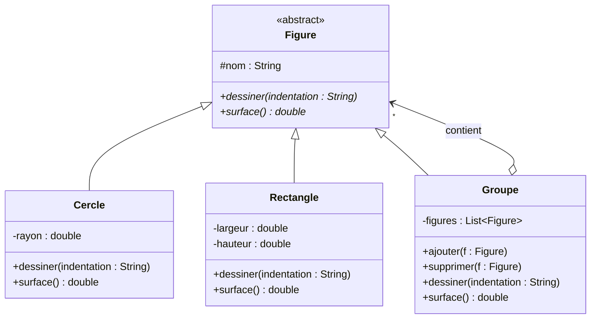
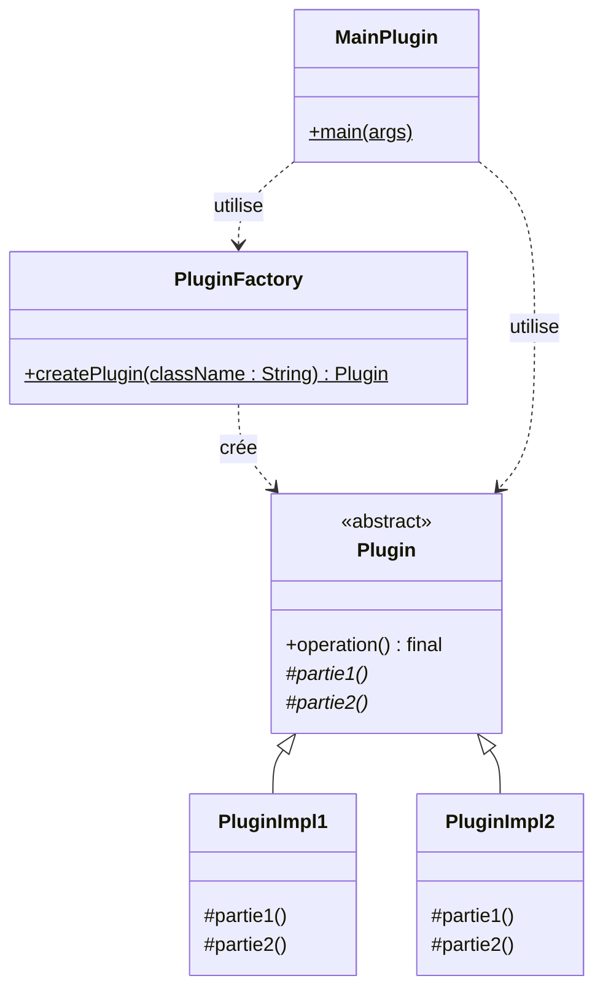
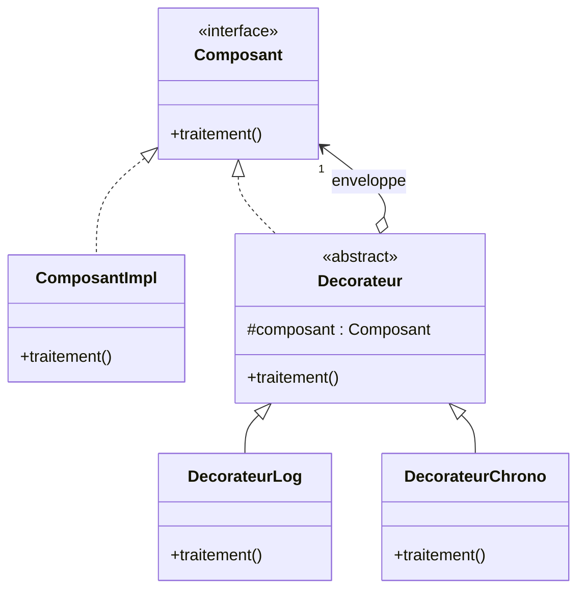
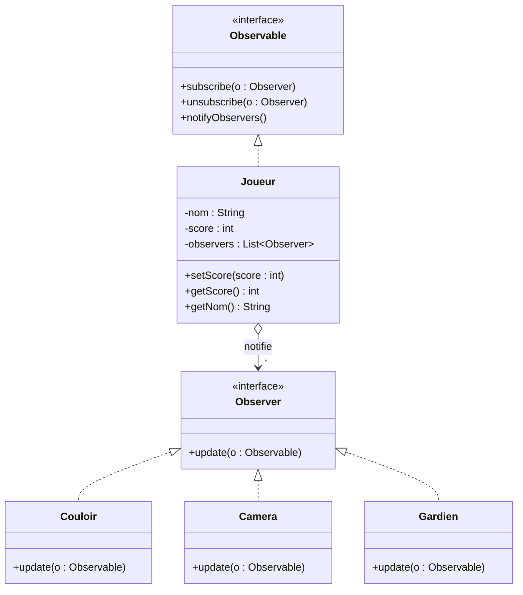

# TP Design Patterns

**Réalisé par :** Chaimaa Zandar — Cycle ingénieur GLSID, ENSET Mohammedia
**Encadrant :** Pr. Mohamed Youssfi
**Langage :** Java (projet Maven)

## Objectif

Identifier, pour chaque situation, le design pattern adapté, établir son diagramme
de classes puis l'implémenter en Java.

## Exercice 1

### 1.1 Figures — pattern Composite

**Situation :** une figure peut être un cercle, un rectangle ou un groupe de figures.

**Justification :** un groupe est lui-même une figure qui contient d'autres figures
(structure arborescente). Le pattern Composite permet de traiter de la même façon un
objet simple (feuille) et un ensemble d'objets (composite) : `dessiner()` ou `surface()`
s'appellent sur un groupe exactement comme sur un cercle.

| Rôle | Classe |
|---|---|
| Component | `Figure` |
| Leaf | `Cercle`, `Rectangle` |
| Composite | `Groupe` |

**Résultat de l'exécution :**

### 1.2 Plugin — Template Method + Factory

**Situation :** une opération implémente le squelette d'un algorithme dont deux parties
sont variables ; le développeur implémente ces parties, et l'application cliente doit
instancier un plugin sans connaître sa classe concrète.

**Justification :**
- **Template Method** : `operation()` (déclarée `final`) fixe l'ordre des étapes et appelle
  les méthodes abstraites `partie1()` et `partie2()` que les sous-classes redéfinissent.
- **Factory** : `PluginFactory` crée l'instance à partir du *nom* de la classe (réflexion
  avec `Class.forName`). Le client ne manipule que le type abstrait `Plugin`.

| Rôle | Classe |
|---|---|
| AbstractClass | `Plugin` |
| ConcreteClass | `PluginImpl1`, `PluginImpl2` |
| Factory | `PluginFactory` |
| Client | `MainPlugin` |

**Résultat de l'exécution :**

### 1.3 Composant — pattern Decorator

**Situation :** ajouter des responsabilités à un composant (des traitements avant et après
`traitement()`) sans modifier son code source.

**Justification :** le décorateur implémente la même interface que le composant et contient
une référence vers un `Composant`. Il exécute son propre traitement avant et après, puis
délègue au composant enveloppé. Les décorateurs peuvent s'empiler librement à l'exécution :
`new DecorateurChrono(new DecorateurLog(new ComposantImpl()))`. Contrairement à l'héritage,
on évite de créer une sous-classe pour chaque combinaison de comportements.

| Rôle | Classe |
|---|---|
| Component | `Composant` |
| ConcreteComponent | `ComposantImpl` |
| Decorator | `Decorateur` |
| ConcreteDecorator | `DecorateurLog`, `DecorateurChrono` |

**Résultat de l'exécution :**

### 1.4 Joueur — pattern Observer

**Situation :** le Couloir, la Caméra et le Gardien doivent être informés à chaque
changement du score du joueur, tout en gardant un couplage faible.

**Justification :** `Joueur` (le sujet observable) garde une liste d'observateurs et ne
connaît que l'interface `Observer`. Les objets de l'environnement s'abonnent avec
`subscribe()` et sont notifiés automatiquement dans `setScore()`. On peut ajouter un nouvel
observateur ou en retirer un (`unsubscribe()`) sans modifier la classe `Joueur`.

| Rôle | Classe |
|---|---|
| Subject | `Observable` |
| ConcreteSubject | `Joueur` |
| Observer | `Observer` |
| ConcreteObserver | `Couloir`, `Camera`, `Gardien` |

**Résultat de l'exécution :**

