# TP Design Patterns

**Réalisé par :** Chaimaa Zandar — Cycle ingénieur GLSID, ENSET Mohammedia
**Encadrant :** Pr. Mohamed Youssfi
**Langage :** Java (projet Maven)

## Objectif

Identifier, pour chaque situation, le design pattern adapté, établir son diagramme
de classes puis l'implémenter en Java.

## Exercice 1

### 1.1 Figures — pattern Composite

**Situation :** une figure peut être un cercle, un rectangle ou un groupe de figures.

**Justification :** un groupe est lui-même une figure qui contient d'autres figures
(structure arborescente). Le pattern Composite permet de traiter de la même façon un
objet simple (feuille) et un ensemble d'objets (composite) : `dessiner()` ou `surface()`
s'appellent sur un groupe exactement comme sur un cercle.

| Rôle | Classe |
|---|---|
| Component | `Figure` |
| Leaf | `Cercle`, `Rectangle` |
| Composite | `Groupe` |

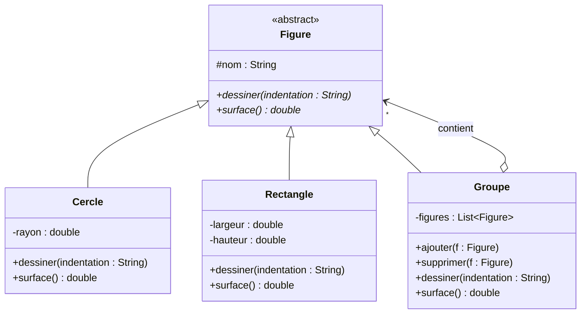

**Résultat de l'exécution :**

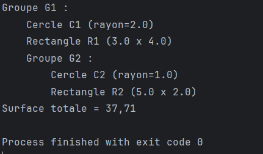

### 1.2 Plugin — Template Method + Factory

**Situation :** une opération implémente le squelette d'un algorithme dont deux parties
sont variables ; le développeur implémente ces parties, et l'application cliente doit
instancier un plugin sans connaître sa classe concrète.

**Justification :**
- **Template Method** : `operation()` (déclarée `final`) fixe l'ordre des étapes et appelle
  les méthodes abstraites `partie1()` et `partie2()` que les sous-classes redéfinissent.
- **Factory** : `PluginFactory` crée l'instance à partir du *nom* de la classe (réflexion
  avec `Class.forName`). Le client ne manipule que le type abstrait `Plugin`.

| Rôle | Classe |
|---|---|
| AbstractClass | `Plugin` |
| ConcreteClass | `PluginImpl1`, `PluginImpl2` |
| Factory | `PluginFactory` |
| Client | `MainPlugin` |

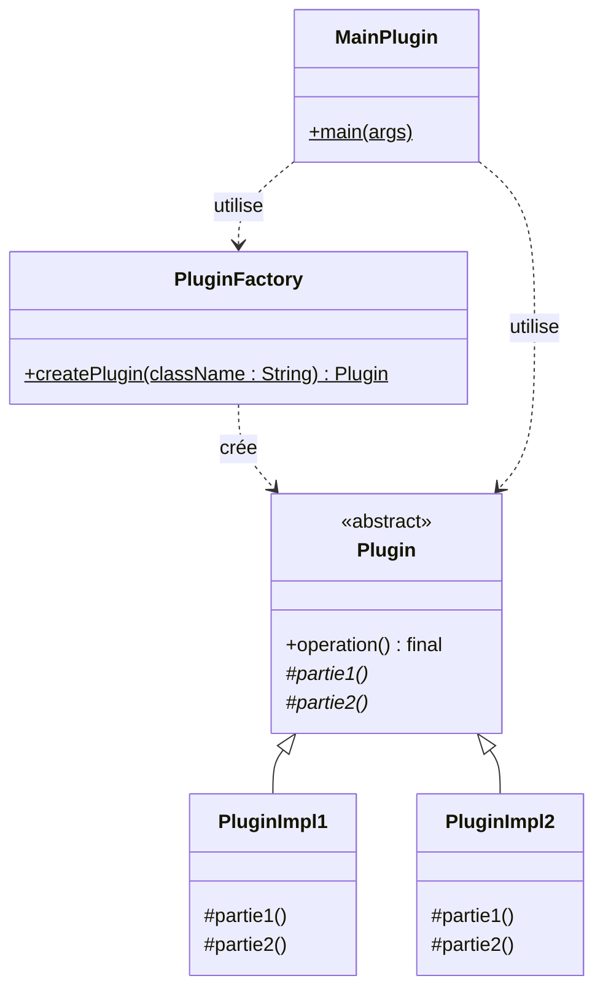

**Résultat de l'exécution :**

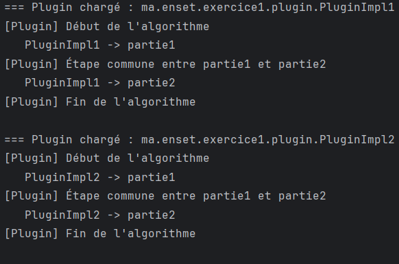

### 1.3 Composant — pattern Decorator

**Situation :** ajouter des responsabilités à un composant (des traitements avant et après
`traitement()`) sans modifier son code source.

**Justification :** le décorateur implémente la même interface que le composant et contient
une référence vers un `Composant`. Il exécute son propre traitement avant et après, puis
délègue au composant enveloppé. Les décorateurs peuvent s'empiler librement à l'exécution :
`new DecorateurChrono(new DecorateurLog(new ComposantImpl()))`. Contrairement à l'héritage,
on évite de créer une sous-classe pour chaque combinaison de comportements.

| Rôle | Classe |
|---|---|
| Component | `Composant` |
| ConcreteComponent | `ComposantImpl` |
| Decorator | `Decorateur` |
| ConcreteDecorator | `DecorateurLog`, `DecorateurChrono` |

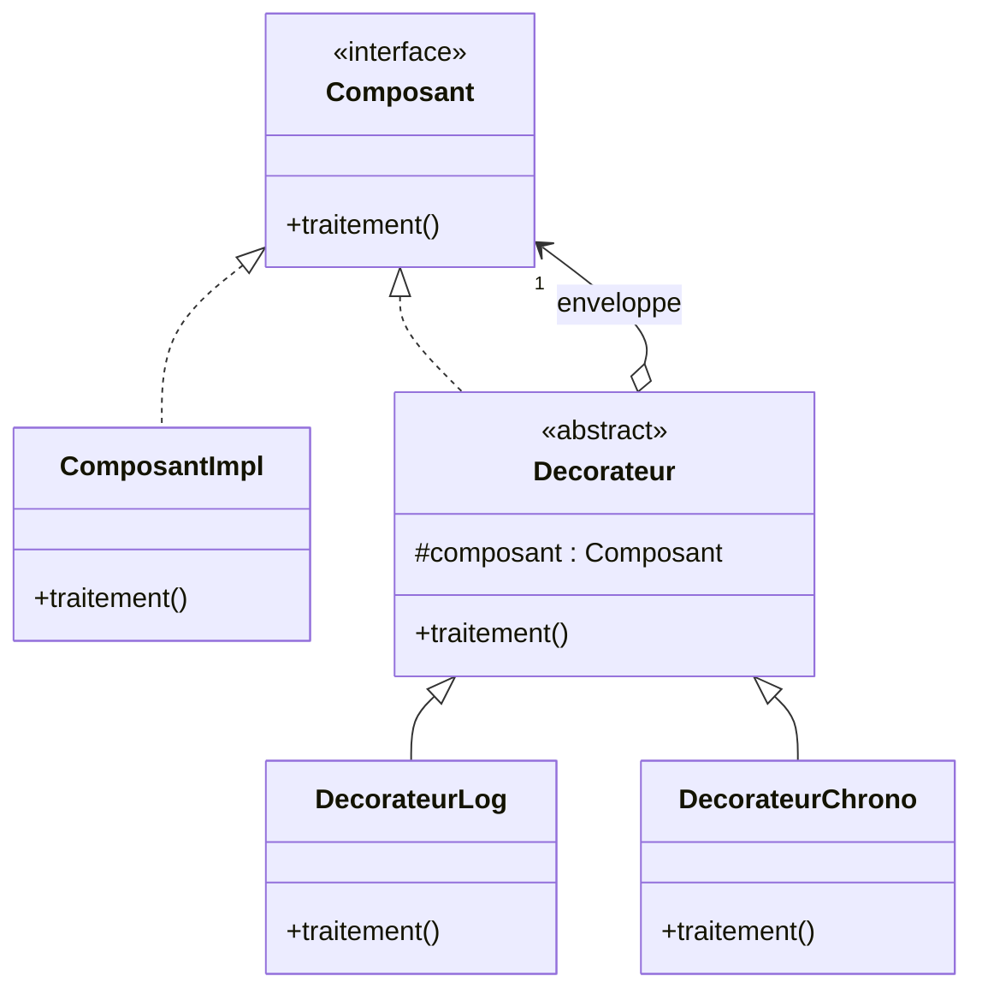

**Résultat de l'exécution :**

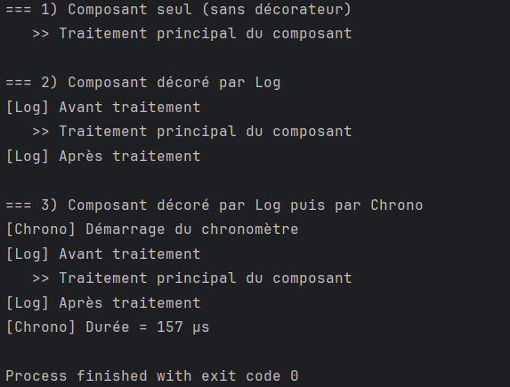

### 1.4 Joueur — pattern Observer

**Situation :** le Couloir, la Caméra et le Gardien doivent être informés à chaque
changement du score du joueur, tout en gardant un couplage faible.

**Justification :** `Joueur` (le sujet observable) garde une liste d'observateurs et ne
connaît que l'interface `Observer`. Les objets de l'environnement s'abonnent avec
`subscribe()` et sont notifiés automatiquement dans `setScore()`. On peut ajouter un nouvel
observateur ou en retirer un (`unsubscribe()`) sans modifier la classe `Joueur`.

| Rôle | Classe |
|---|---|
| Subject | `Observable` |
| ConcreteSubject | `Joueur` |
| Observer | `Observer` |
| ConcreteObserver | `Couloir`, `Camera`, `Gardien` |

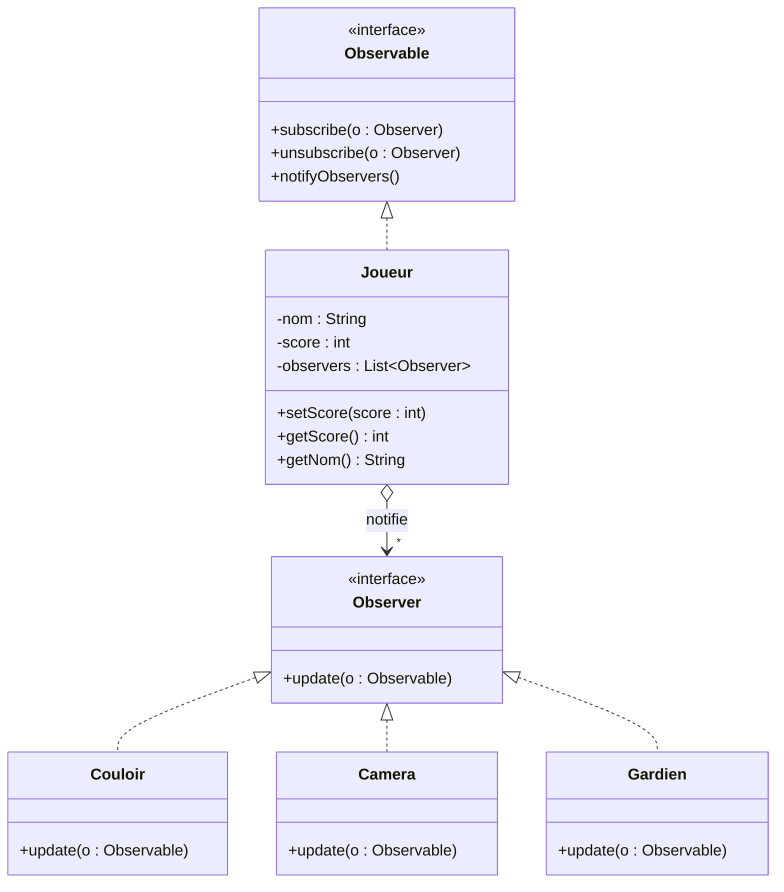

**Résultat de l'exécution :**

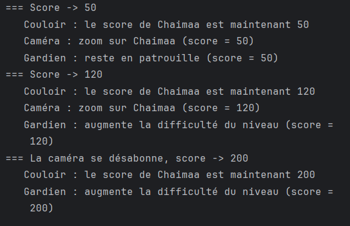

## Exercice 2 : Framework de traitement d'images

### Analyse des exigences

| Exigence | Pattern | Mise en œuvre |
|---|---|---|
| Fermé à la modification, ouvert à l'extension | Principe OCP | Le framework ne dépend que d'abstractions (`Filtre`, `Compresseur`) |
| Le filtrage peut évoluer ; l'utilisateur crée ses propres filtres | **Strategy** | Interface `Filtre` + implémentations `FiltreNegatif`, `FiltreSeuil` |
| Changer dynamiquement de filtre à l'exécution | **Strategy** | `ImageProcessor.setFiltre(...)` |
| Réutiliser `ImplNonStandard.appliquerFiltre(String, int[])` | **Adapter** | `ImplNonStandardAdapter implements Filtre` |
| Squelette de la compression, détails dans les sous-classes | **Template Method** | `Compresseur.compresser()` (final) appelle `compresserDonnees()` (abstraite) |
| Choix des classes par l'utilisateur | Réflexion | `Class.forName(nom)` |

### Question 1 : Diagramme de classes

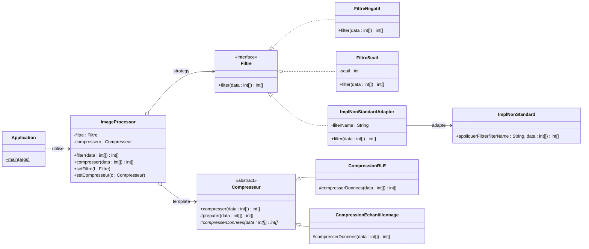

**Rôles des patterns :**

- **Strategy** — Context : `ImageProcessor` · Strategy : `Filtre` · ConcreteStrategy : `FiltreNegatif`, `FiltreSeuil`, `ImplNonStandardAdapter`
- **Adapter** (adaptateur objet) — Target : `Filtre` · Adapter : `ImplNonStandardAdapter` · Adaptee : `ImplNonStandard`
- **Template Method** — AbstractClass : `Compresseur` · ConcreteClass : `CompressionRLE`, `CompressionEchantillonnage`

### Question 2 : Implémentation Java

#### a) Strategy — le filtrage

L'interface `Filtre` est le contrat que doit respecter toute opération de filtrage.
Chaque filtre est une stratégie concrète ; l'utilisateur peut en écrire de nouvelles sans
modifier le framework.

```java
public interface Filtre {
    int[] filter(int[] data);
}
```

Exemple de stratégie concrète :

```java
public class FiltreNegatif implements Filtre {
    @Override
    public int[] filter(int[] data) {
        int[] resultat = new int[data.length];
        for (int i = 0; i < data.length; i++) {
            resultat[i] = 255 - data[i];
        }
        return resultat;
    }
}
```

Implémentations fournies :
- `FiltreNegatif` : négatif de l'image (`255 - pixel`)
- `FiltreSeuil` : binarisation noir/blanc selon un seuil

**Test (`TestFiltres`) :**

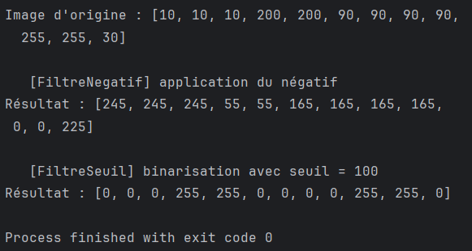

#### b) Adapter — réutiliser l'ancienne implémentation

L'ancienne classe `ImplNonStandard` propose `appliquerFiltre(String filterName, int[] data)`,
une signature incompatible avec l'interface `Filtre` du framework (nom différent et paramètre
supplémentaire). Plutôt que de la modifier, on crée un adaptateur qui implémente `Filtre` et
traduit l'appel `filter(data)` en `appliquerFiltre(filterName, data)`. Le nom du filtre est
fourni à la construction de l'adaptateur.

| Rôle | Classe |
|---|---|
| Target | `Filtre` |
| Adapter | `ImplNonStandardAdapter` |
| Adaptee | `ImplNonStandard` |

```java
public class ImplNonStandardAdapter implements Filtre {
    private final ImplNonStandard implNonStandard = new ImplNonStandard();
    private final String filterName;

    public ImplNonStandardAdapter(String filterName) {
        this.filterName = filterName;
    }

    @Override
    public int[] filter(int[] data) {
        return implNonStandard.appliquerFiltre(filterName, data);
    }
}
```

Il s'agit d'un **adaptateur objet** (par composition) : l'adaptateur contient une instance de
l'ancienne classe au lieu d'en hériter.

**Test (`TestAdapter`) :**

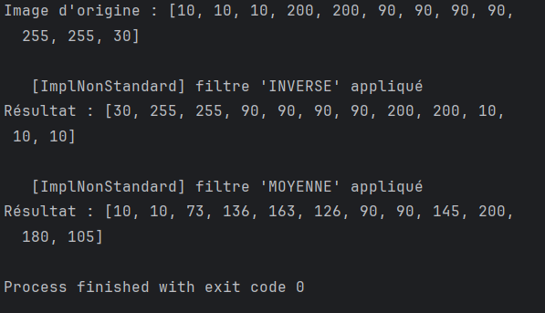

#### c) Template Method — la compression

La classe abstraite `Compresseur` définit le squelette de l'algorithme de compression dans la
méthode `compresser()`, déclarée `final` pour que l'ordre des étapes ne puisse pas être modifié.
Seule l'étape `compresserDonnees()` est abstraite et déléguée aux sous-classes.

| Étape | Visibilité | Rôle |
|---|---|---|
| `verifier(data)` | `private` | Étape commune fixe : refuse une image nulle |
| `preparer(data)` | `protected` | Hook : copie des données, redéfinissable |
| `compresserDonnees(data)` | `protected abstract` | Étape variable, implémentée par les sous-classes |
| `afficherTaux(...)` | `private` | Étape commune fixe : affiche le gain |

```java
public abstract class Compresseur {
    public final int[] compresser(int[] data) {
        verifier(data);
        int[] copie = preparer(data);
        int[] resultat = compresserDonnees(copie);
        afficherTaux(data, resultat);
        return resultat;
    }

    protected abstract int[] compresserDonnees(int[] data);
}
```

Implémentations fournies :
- `CompressionRLE` : Run-Length Encoding, compression sans perte (`[5,5,5,7,7]` → `[3,5,2,7]`)
- `CompressionEchantillonnage` : compression avec perte, conserve un pixel sur deux

**Test (`TestCompression`) :**

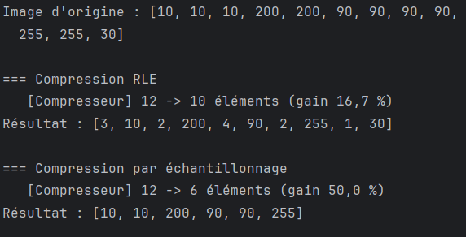