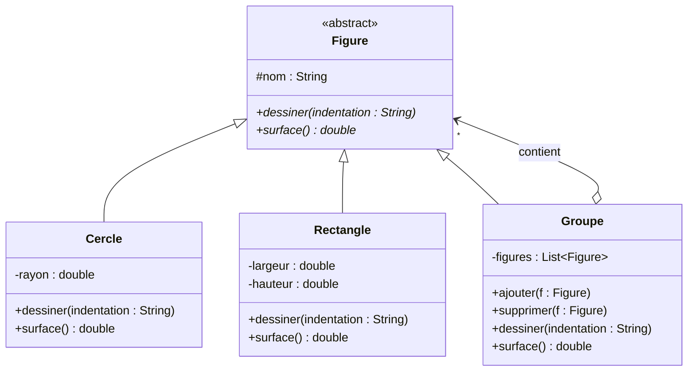

# TP Design Patterns

**Réalisé par :** Chaimaa Zandar — Cycle ingénieur GLSID, ENSET Mohammedia
**Encadrant :** Pr. Mohamed Youssfi
**Langage :** Java (projet Maven)

## Objectif

Identifier, pour chaque situation, le design pattern adapté, établir son diagramme
de classes puis l'implémenter en Java.

## Exercice 1

### 1.1 Figures — pattern Composite

**Situation :** une figure peut être un cercle, un rectangle ou un groupe de figures.

**Justification :** un groupe est lui-même une figure qui contient d'autres figures
(structure arborescente). Le pattern Composite permet de traiter de la même façon un
objet simple (feuille) et un ensemble d'objets (composite) : `dessiner()` ou `surface()`
s'appellent sur un groupe exactement comme sur un cercle.

| Rôle | Classe |
|---|---|
| Component | `Figure` |
| Leaf | `Cercle`, `Rectangle` |
| Composite | `Groupe` |

**Résultat de l'exécution :**

